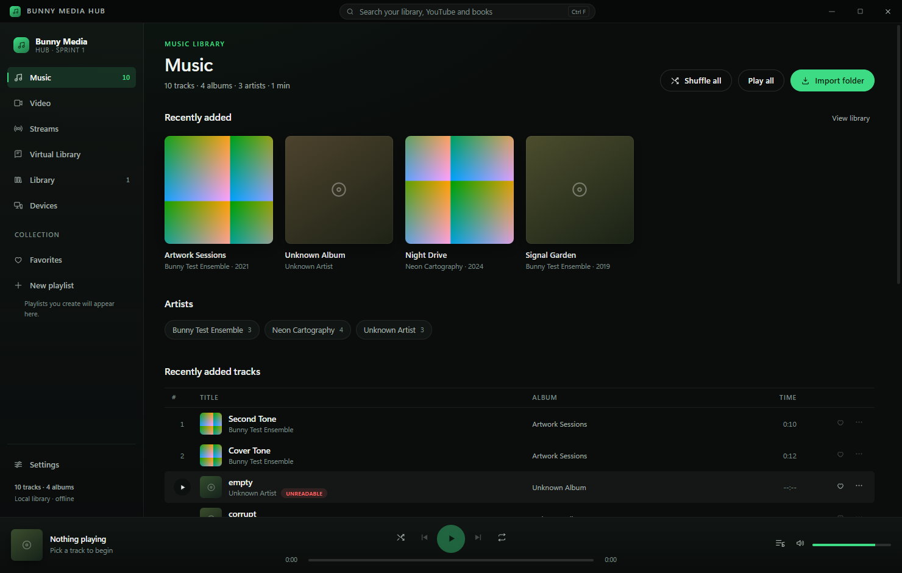

# Bunny Media Hub

A desktop media application for the Bunny ecosystem: a local music player first, with public-catalogue discovery (books, audiobooks, archive audio and film) and network stream playback built on documented APIs.

Sprint 1 scope is a reliable local music player, an equalizer, honest catalogue search and a working network stream player. Spotify/Apple Music libraries and device sync are designed for but **not implemented** — see [docs/SPRINT1-REPORT.md](docs/SPRINT1-REPORT.md).



## Open the app

Three ways, depending on what you want:

| Goal | Command |
| --- | --- |
| Just open it (Windows) | Double-click `launch.cmd` |
| Development with hot reload | `npm install` then `npm run dev` |
| Run the built app | `npm run build` then `npm start` |

`launch.cmd` installs dependencies the first time, rebuilds the app from the current source on every launch (so it never runs stale code), then starts Electron. You can also run `node_modules\.bin\electron .` after a manual `npm run build`.

Requirements: Node.js 20 or newer (developed on Node 24, Windows 11) and a desktop session with audio output. No account, key or network connection is required for local playback.

## What works today

- **Local library**: import a folder, incremental scanning in a worker thread, metadata and embedded cover art, album/artist/track browsing, search.
- **Real playback** through Chromium's audio pipeline with a custom `bunny-media://` protocol (HTTP range support, no filesystem paths in the renderer).
- **Transport**: play/pause, seek, volume, next/previous, shuffle, repeat one/all, queue panel, drag-free queue management.
- **Equalizer**: five bands (60 Hz – 14 kHz), presets, an independent **extra-bass** slider (80 Hz low shelf) and an **audio boost** slider up to 300% with a soft limiter — all persisted and applied inside the player.
- **Lyrics**: embedded tags, `.lrc`/`.txt` sidecar files, and an LRCLIB lookup as a fallback, with synced lines following the playhead in Now Playing.
- **Playlists and favorites** persist across restarts, along with the last track, queue and position.
- **Virtual Library**: one search across Open Library, Project Gutenberg (with an Internet Archive mirror fallback), LibriVox and the Internet Archive.
- **Streams**: paste a direct media URL, an HLS (`.m3u8`) playlist or an M3U/PLS channel list. Links are checked before they are saved, a channel list is expanded into entries, and playback survives leaving the screen (the player docks to the corner). Formats Chromium cannot decode — MKV, AVI, MPEG-TS, HEVC — are handed to VLC with the same URL instead of failing silently.
- **Suggested streams on first launch**: a small curated set of *legal, publicly offered* links — public radio (SomaFM, Radio Paradise, Radio Swiss Classic), NASA's public live HLS stream, and public-domain film and audiobooks from the Internet Archive. They are added once; delete any you do not want and they stay deleted. No IPTV lists, trackers or indexer APIs are bundled.
- **YouTube**: search with no key at all — from the Video screen or the search field at the top — then watch in YouTube's own embedded player with the app's transport controls, queue, saved videos and recently played history. The player docks to the corner while you browse other screens (a video keeps playing while you look through the library, and it stays visible on purpose: YouTube's terms forbid hidden playback). A Data API key is optional and only changes the search path.
- **Settings**: theme accent, rescan on launch, equalizer, YouTube key, library tools, build information.

## What is planned, not built

A browsable video catalogue beyond YouTube, Spotify / Apple Music libraries, Bunny Sync and multi-device playback, in-app browser tabs, downloads, accounts, torrent/indexer metadata APIs. The provider layer records exactly what each service allows in [docs/PROVIDER-FEASIBILITY.md](docs/PROVIDER-FEASIBILITY.md); nothing here pretends those features exist.

## Commands

```bash
npm install          # install dependencies
npm run dev          # Electron + Vite with hot reload
npm run build        # typecheck both processes and build to out/
npm start            # run the built app (electron-vite preview)
npm test             # 166 unit tests (vitest)
npm run test:e2e     # build, then 9 end-to-end tests against the real app
npm run bench        # cold start + 300-track import responsiveness
npm run typecheck    # tsc for the node and web projects
node scripts/check-youtube.mjs        # live YouTube search → real playback check (needs a build)
node scripts/check-youtube-dock.mjs   # live check that playback survives leaving the Video screen
node scripts/check-streams.mjs        # live stream check: local server + M3U import + HLS playback
```

End-to-end tests drive the real Electron app with Playwright, import a generated fixture library, play MP3/WAV/FLAC audio, restart the app and verify persistence. Screenshots are written to `screenshots/`.

## Where your data lives

Everything is local JSON under Electron's `userData` folder:

```
%APPDATA%\Bunny Media Hub\   (Windows)
~/Library/Application Support/Bunny Media Hub/   (macOS)
~/.config/Bunny Media Hub/   (Linux)

library.json     folders, tracks (including lyrics found at scan time), last scan summary
playlists.json   playlists and favorites
settings.json    volume, equalizer curve, boost, bass, accent, YouTube key
session.json     last track, queue and position
streams.json     saved network stream links (URLs only, never media)
artwork/         cached cover images (deduplicated by hash)
```

Settings → Library → **Open data folder** takes you there.

## Online catalogues and the law

- Open Library, Project Gutenberg, LibriVox and the Internet Archive are queried through their public read APIs, with a descriptive User-Agent, bounded timeouts and no retries in a loop.
- YouTube search needs no key: it uses the same public search request YouTube's own web player makes, and falls back to the documented Data API v3 when you add a key. Playback always happens in the official embedded player, because YouTube's developer policies forbid extracting audio, hiding the player or background playback. On the Video screen that player is the stage; elsewhere it docks into the corner, still on screen and still at least 366×206 px. Minimising the window pauses it. No stream URL is ever resolved.
- Streams are links **you** supply. The app does not search trackers, resolve stream endpoints, bundle a catalogue or scrape indexers; it plays an http(s) URL you paste, or the channel entries inside an M3U/PLS list you import. Media is fetched by the main process through the app's own `bunny-stream:` protocol, which is a pass-through — nothing is downloaded to disk, cached, or re-broadcast. Rights to the content remain yours to check, exactly as with a browser or VLC.
- Lyrics come from your files first. When neither a tag nor a sidecar file exists, the app asks [LRCLIB](https://lrclib.net), a free open lyrics service; only the track title, artist, album and duration are sent.
- Copyrighted books (for example Margaret Peterson Haddix's *The Missing* series) are **not** downloadable here. Open Library links to legal borrowing; your local library's Libby/OverDrive catalogue is the usual free route.

## Project layout

```
src/core/        models, queue and search logic, player controller, provider contracts
src/main/        Electron main process: storage, scanner worker, media protocol, IPC, catalogue clients
src/preload/     contextBridge API (contextIsolation + sandbox on)
src/renderer/    React UI: views, components, state, theme, audio engine
tests/           unit tests, fixture generator, end-to-end tests
docs/            architecture, testing, dependencies, provider feasibility, sprint report
```

## More documentation

- [YouTube search and playback](docs/YOUTUBE.md)
- [Architecture](docs/ARCHITECTURE.md)
- [Testing and manual playback verification](docs/TESTING.md)
- [Dependency and licence inventory](docs/DEPENDENCIES.md)
- [Provider feasibility report](docs/PROVIDER-FEASIBILITY.md)
- [Sprint 1 report](docs/SPRINT1-REPORT.md)
- [Phase 0 stack decision](docs/PHASE0-STACK.md)

## Troubleshooting

- **No sound**: check the volume slider in the player bar, then Windows volume mixer. The equalizer never mutes the output — with it disabled, audio goes straight to the device.
- **A file will not play**: the row shows the decoder error. FLAC/MP3/WAV are verified; M4A/AAC/OGG/Opus/WebM are accepted by the scanner but not yet playback-verified in this build.
- **Catalogue search shows an error**: the public API is unreachable or rate-limiting. Local playback is unaffected.
- **A stream says it needs an external player**: Chromium has no decoder for that container (MKV, AVI, MPEG-TS, HEVC). Use **Open in VLC** on the row; VLC is launched with the same URL when installed, otherwise your default handler opens it.
- **A stream does not play but the link works in a browser**: many stream servers require a referer or block non-browser user agents. The app sends a plain descriptive User-Agent and no spoofed referer, so those links are reported as errors rather than silently retried.
